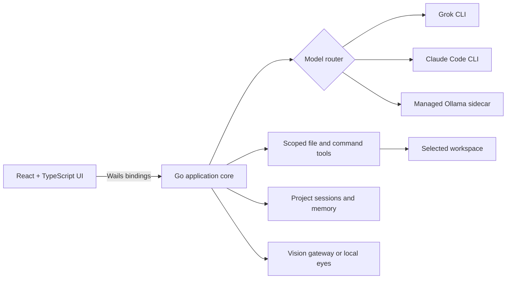

<div align="center">
  
  <h1>AH-Code</h1>
  <p><strong>A local-first AI coding workspace for building, inspecting, and repairing software from one native desktop app.</strong></p>

  <p>
    
    
    
    
    
  </p>
</div>

AH-Code turns AI chat into an executable development loop. It gives cloud coding agents and private local models the same project-aware workspace, then connects them to controlled file tools, terminal execution, build feedback, visual context, and persistent sessions.

## Why AH-Code

Most AI coding tools force a choice between capable cloud agents and private local inference. AH-Code treats them as interchangeable execution engines behind one focused desktop experience:

- **Choose the right engine** — Grok, Claude Code, or local Qwen2.5-Coder models through Ollama.
- **Work against a real repository** — inspect project files, apply targeted edits, detect build commands, and run tools in the selected workspace.
- **Close the feedback loop** — capture command output and return failures to the model for iterative correction.
- **Keep local work local** — run an isolated Ollama sidecar on loopback, store application data outside the repository, and support remote Ollama endpoints when more compute is needed.
- **Build with visual context** — attach screenshots and route them through local or gateway-backed vision analysis before code generation.

## Technical Highlights

| Area | Implementation |
| --- | --- |
| Native desktop shell | Go backend with Wails v2 and a React 19 + TypeScript interface |
| Agent orchestration | Streaming Grok and Claude Code sessions, cancellation, reasoning visibility, and session recovery |
| Local inference | Managed Ollama lifecycle with Qwen2.5-Coder 7B, 14B, and 32B profiles |
| Tool execution | Project-scoped file reads/writes, command execution, build detection, and guarded destructive actions |
| Multimodal input | Image persistence, resizing, multi-image prompts, local vision discovery, and cloud vision fallback |
| Workspace memory | Per-project conversation history, recent-workspace recovery, cache health, pruning, and quota telemetry |
| Hardware awareness | CPU, RAM, GPU, and VRAM detection with model compatibility recommendations |
| Web context | Keyless search tool with bounded results, timeouts, and sanitized model context |

## Architecture



The Go layer owns process isolation, model lifecycle, workspace boundaries, and persistence. The frontend receives typed Wails bindings and renders streaming model output, tool activity, installation progress, health signals, and diffs without exposing shell internals to the browser layer.

## Getting Started

### Prerequisites

- Windows 10 or 11
- Go 1.25+
- Node.js 20+
- [Wails CLI v2](https://wails.io/docs/gettingstarted/installation)
- Optional: Grok CLI, Claude Code CLI, or an existing Ollama installation

### Run in development

```powershell
git clone https://github.com/gm456789123-code/AH-Code.git
cd AH-Code
cd frontend
npm install
cd ..
wails dev
```

AH-Code can manage its own Ollama sidecar. Cloud engines remain opt-in and use their own authenticated CLI sessions.

### Build

```powershell
wails build
```

The Windows binary is written to `build/bin/AH-Code.exe`.

## Validation

```powershell
go test ./...
cd frontend
npm run build
```

The repository includes unit and integration coverage for model routing, streaming sessions, vision behavior, workspace tools, safe command handling, persistence, and build detection. Tests that exercise local model behavior expect a compatible Ollama test environment.

## Repository Map

```text
frontend/        React + TypeScript desktop interface
web/             Optional account, quota, and vision gateway
app.go           Desktop API, orchestration, and session management
engine.go        Ollama lifecycle and remote inference configuration
models.go        Model registry, local chat, attachments, and tool loop
gateway.go       Authentication and vision gateway integration
tools_files.go   Project-scoped file operations
websearch.go     Bounded web-search tool for local models
```

## Security and Privacy

- Secrets and runtime databases are excluded from source control; only `web/.env.example` is published.
- Local model traffic stays on loopback unless a remote Ollama endpoint is explicitly configured.
- Project tools validate workspace paths before reading or modifying files.
- Generated builds, caches, editor settings, and agent-specific configuration are not committed.

## Project Status

AH-Code is an actively developed prototype focused on practical agent orchestration, local inference, and safe project automation. The current desktop target is Windows.
